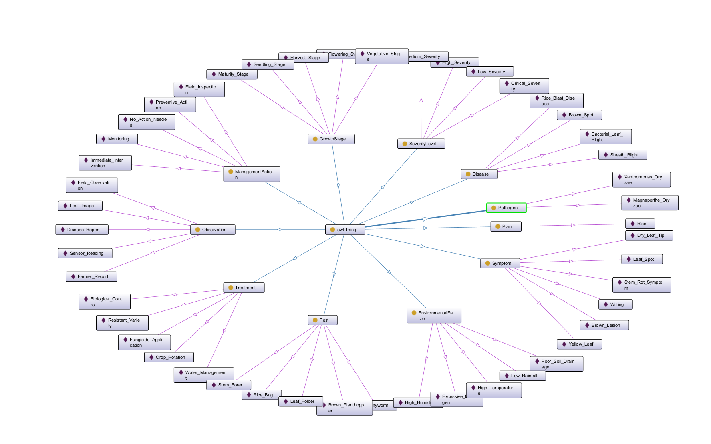

# Rice MMKG — Rice Multimodal Knowledge Graph

An OWL 2 ontology and multimodal knowledge graph modeling rice diseases, pests, pathogens, symptoms, environmental factors, growth stages, treatments, and management actions — populated from public image, sensor, light-trap and multispectral datasets, with text reports as a declared extension point.



## Overview

Rice MMKG links agronomic, pathological, and entomological knowledge about rice cultivation into a single queryable graph, connecting what is *observed* (currently: 21,149 images from six datasets, 186 plot-level soil and weather observations, 11,533 light-trap catches of brown planthopper and 472 multispectral captures of brown spot; field/text reports are a declared extension point) to its *cause* (pathogens, pests, environmental stressors) and the *response* (treatments, management actions), contextualised by crop growth stage and severity level.

### Core Design Principles

- **Observation is kept separate from domain knowledge.** An `ImageObservation`'s raw dataset label (`annotatedAs`) is never conflated with curated symptom/cause/treatment relations (`captures`, `causes`, `indicatedBy`, ...) — what was recorded by computer vision is distinct from what is concluded by domain knowledge.
- **Every domain-level assertion is traceable.** All 377 populated domain triples (`causes`, `indicatedBy`, `occursIn`, `controlledBy`, `preventedBy`, `increaseRiskOf`, `vulnerableTo`, `recommends`, `requires`, `transmits`, `affectsPlantPart`, `partOf`, `hasTransmissionMode`, `hasManagementCategory`, `varietyOf`, `hasPathogenGroup`) are reified with `owl:Axiom` and carry `dcterms:source`, `dcterms:bibliographicCitation`, and `rice:evidenceType` — **100% provenance coverage as of v0.6.1**, checked by CQ-22 (assertions without an axiom) as well as CQ-21 (axioms without a source). v0.6 fell two assertions short of this; see the v0.6.1 note in [`Ontology_Overview.md`](Ontology/Ontology_Overview.md).
- **Formal reasoning & falsifiable Competency Questions.** Evaluated under automated Description Logic (HermiT/Pellet) and rule-based (OWL RL) reasoning across 27 schema-level Competency Questions without permissive `OPTIONAL` clauses.

### Metadata Snapshot

- **Namespace:** `https://w3id.org/ricemmkg#` — permanent identifier, live since 2026-09-16; version IRIs `https://w3id.org/ricemmkg/<version>` (releases up to v0.6.2 used `http://www.semanticweb.org/arifu/ontologies/2026/3/riceMMKG#`)
- **Format:** OWL/XML (`.rdf`), fully compatible with [Protégé](https://protege.stanford.edu/)
- **Version:** `0.7.0-dev` on `main` (in development; last release `v0.6.2`, 2026-09-15; git tags `v0.6.1`, `v0.6.2`; v0.6 released 2026-09-03) — target venue under review (ESWC 2027 dropped on 2026-09-29; see [Roadmap](#roadmap))
- **Triples:** **321,506** asserted triples / **622,666** materialised triples under OWL RL (measured 2026-10-21); the rise from 68,204 is the Paddy Doctor IEEE release, Dhan-Shomadhan images, the first sensor observations, the YUKE-WBC planthopper images, the stem borer symptom images, the nutrient deficiency images, the light-trap catches, the multispectral captures and 41 alignment links to SOSA, RiceDO and TreatO; v0.6.2: 66,802 / 161,447
- **Reasoner Consistency:** **100% Consistent** in HermiT & Pellet (0 unsatisfiable classes, 0 disjointness conflicts)

---

## Ontology Structure

### Classes (29)

28 classes in the `rice:` namespace and `dcat:Dataset`. The table lists the observation layer and the main domain classes; the others are `AbioticFactor` (6 individuals), `PlantPart` (10), `ManagementCategory` (4), `PathogenGroup` (4), `TransmissionMode` (1), `Variety` (12), `ResistanceAssessment` (15) and `ResistanceLevel` (3). Counts measured 2026-10-15.

| Class | Individuals | Description |
|---|---:|---|
| `ImageObservation` | 21,149 | Paddy Doctor IEEE DataPort release 16,225, Dhan-Shomadhan 1,106, YUKE-WBC brown planthopper 66, stem borer symptom images 2,096, nutrient deficiency images 1,156 (Kaggle, licence not stated, permission requested) and 500 (Netrokona, potassium, label not expert-validated); the last four added 2026-10-13 |
| `SymptomaticObservation` | *(2,544 materialised)* | Defined class (`Observation that captures some Symptom`) — populated via OWL reasoning |
| `SensorObservation` | 186 | Plot soil tests (pH, EC, organic carbon, N, P, K) and weather, Rice Disease Risk Assessment v1.0, Odisha (2026-10-05) |
| `TrapObservation` | 11,533 | Light-trap catches of brown planthopper at 229 stations in China, 1977–2019, per five- or six-day period in July (2026-10-13) |
| `FieldLocation` | 418 | WGS84 points of the sensor observations (184), the light-trap stations (229), the multispectral captures (3), and one approximate location each for the YUKE-WBC and the Kaggle nutrient deficiency photos |
| `RemoteSensingObservation` | 472 | Close-range multispectral captures of brown spot and healthy rice, Colombia: one RGB image and five band images each (2026-10-14). The label is that of the plot; no NDVI is stored |
| `BandImage` / `SpectralBand` | 2,360 / 5 | One image file per band of a capture; the five bands of the camera (450–840 nm) |
| `Observation` | 0 | Abstract root observation superclass |
| `Dataset` (`dcat:Dataset`) | 9 | Metadata individuals for the Paddy Doctor, Dhan-Shomadhan, YUKE-WBC, stem borer symptom, Kaggle nutrient deficiency and Netrokona image collections, the Rice Disease Risk Assessment table, the brown planthopper light-trap table and the brown spot multispectral set |
| `Disease` | 16 | 10 biotic diseases & damage conditions (including `Deadheart`, Bacterial Leaf Blight, Rice Blast, Tungro, Sheath Blight, Leaf Scald) and 6 abiotic disorders (N, P, K, Zn deficiency, iron toxicity, salinity; 0.7.0-dev) |
| `Pest` | 7 | Insect pests and vectors (Stem Borer, Leaf Folder, Brown Planthopper, Armyworm, Rice Bug, Hispa, Green Leafhopper) |
| `Pathogen` | 10 | Microbial causal agents (Magnaporthe Oryzae, Rhizoctonia solani, Xanthomonas pathovars, Microdochium albescens, RTBV, RTSV) |
| `Plant` | 1 | The host crop (*Oryza sativa*) |
| `HealthStatus` | 1 | Non-disease reference baseline (`Normal_Health`) |
| `Symptom` | 40 | Visual symptoms (Leaf Rolling, Dead Tiller, White Ear, Brown Lesion, Wilting, etc.) |
| `GrowthStage` | 7 | Rice phenological stages (Seedling, Tillering, Vegetative, Reproductive, Flowering, Maturity, Harvest) |
| `EnvironmentalFactor` | 9 | Predisposing weather & field conditions (High Humidity, Waterlogged Soil, Dense Canopy, etc.) |
| `SeverityLevel` | 4 | Severity levels (Low, Medium, High, Critical), each annotated with the matching attack-intensity category of the 2021 Indonesian pest-observation guideline; no severity → action mapping is asserted (0.7.0-dev) |
| `Treatment` | 16 | Practical interventions (Fungicide/Insecticide Application, Biological Control, Resistant Variety, Crop Rotation, and fertilizer application for N, P, K and Zn) |
| `ManagementAction` | 5 | Operational actions (Field Inspection, Monitoring, Immediate Intervention, Preventive Action, No Action Needed) |

### Object Properties (42)

All declared with a domain and a range, except the entailed `hasAffectedPart` (range only); inverse pairs share them in reverse.

- **Domain relations:** `causes`/`causedBy`, `transmits`/`transmittedBy`, `threatens`, `indicates`/`indicatedBy`, `controls`/`controlledBy`, `prevents`/`preventedBy`, `recommends`/`recommendedFor`, `requires`/`requiredFor`, `occursIn`, `hasOccurrenceOf`, `increaseRiskOf`/`riskIncreasedBy`, `vulnerableTo`, `affectsPlantPart`, `hasAffectedPart` (entailed by the chains `indicatedBy ∘ affectsPlantPart` and `hasAffectedPart ∘ partOf`, never asserted), `partOf`, `hasTransmissionMode`, `hasManagementCategory`, `hasPathogenGroup`.
- **Varieties and resistance:** `varietyOf`/`hasVariety`, `assessedVariety`/`hasResistanceAssessment`, `assessedAgainst`, `hasResistanceLevel`, `ofVariety`.
- **Observation layer:** `annotatedAs`/`annotationOf`, `captures`/`capturedBy`, `detects`/`detectedBy`, `hasSpatialLocation`, `hasBandImage`, `ofBand`.

*Epidemiological distinction:* `causes` is strictly scoped to `Pathogen → Disease`, while insect vector transmission is modeled through `transmits`/`transmittedBy` (`Pest → Pathogen`), enabling explicit graph traversal from vector to pathogen to disease.

### Datatype Properties (27)

- **Observation values:** `recordedAtDate`, `recordedUntilDate`, `hasCatchCount`, `plantAgeDays`, `environmentCondition`, `sourceLabel`; soil and weather `hasSoilPH`, `hasElectricalConductivity`, `hasOrganicCarbon`, `hasNitrogenLevel`, `hasPhosphorusLevel`, `hasPotassiumLevel`, `hasTemperature`, `hasHumidity`, `hasRainfall`; `hasNDVI`.
- **Places and bands:** `hasLatitude`, `hasLongitude`, `centreWavelengthNm`.
- **Assessments and labels:** `testedPopulation`, `testedLocation`, `reportedYear`, `sourceDatasetLabel`.
- **Declared, not yet used:** `confidenceScore`, `severityScore`, `interventionThreshold`, `observationDate`, `hasNDVI`.

### Individuals & Provenance

- **36,303 named individuals**: 21,149 `ImageObservation` instances, 11,533 `TrapObservation` instances, 472 `RemoteSensingObservation` instances with 2,360 `BandImage`s, 186 `SensorObservation` instances, 418 `FieldLocation`s, 9 dataset metadata individuals, plus 176 domain entities (0.7.0-dev).
- **377 reified domain axioms** over 377 domain assertions: every assertion backed by an `owl:Axiom` record with `dcterms:source`, `dcterms:bibliographicCitation`, and `rice:evidenceType`. Source URIs: CABI Compendium 243 (as `doi.org/10.1079/cabicompendium.*` DOIs), IRRI Rice Knowledge Bank / Rice Doctor 100, NCBI Taxonomy 10, Paddy Doctor dataset 6, Mackill & Khush (2018) 3, AGROVOC 4, IRAC 3, Plant Ontology 2, Wang et al. (2022) 2, Bagariang et al. (2021) 2, Biswas et al. (2021) 1, FAO 1. The 15 resistance assessments carry the same three annotations on the assessment itself.
- **Vector transmission mode (0.7.0-dev):** both tungro viruses are recorded as semi-persistently transmitted (`hasTransmissionMode`), citing Wang et al. (2022).
- **Abiotic causes (0.7.0-dev):** nitrogen, phosphorus, potassium and zinc deficiency, and on the excess side iron toxicity and salinity, are modelled as `AbioticFactor`s that cause disorders, with symptoms from the IRRI Rice Knowledge Bank fact sheets — so abiotic factors, like pathogens, end at a Disease.
- **Varieties (0.7.0-dev):** `IR64`, `Angke` and `Conde` (bred from IR64), `Ciherang`, `Inpari_32` and `Inpari_33`. Each reported grade is a `ResistanceAssessment` naming the variety, the disease or pest, the grade (resistant, moderately resistant, susceptible), the tested biotype, race or population, the year and its own source — 15 assessments from Mackill & Khush (2018), Bagariang et al. (2021) and Biswas et al. (2021). Conflicting grades stay side by side, and a resistance that broke down shows as assessments from different years.
- **Management categories (0.7.0-dev):** treatments are classed as chemical, biological, cultural or host-plant-resistance control (`hasManagementCategory`, categories from AGROVOC) where a source places them unambiguously.
- **Plant anatomy (0.7.0-dev):** 8 `PlantPart` individuals aligned to the Plant Ontology; each symptom linked to the organ it affects (`affectsPlantPart`), with `partOf` where the Plant Ontology records it.
- **External Alignment**: 70 `skos:exactMatch`, 31 `skos:closeMatch`, 18 `skos:broadMatch`, 4 `skos:relatedMatch` to AGROVOC, NCBI Taxonomy, Plant Ontology, PECO, BFO, SOSA, WGS84, RiceDO v2 and TreatO v2 (counted 2026-10-19). The observation layer is aligned to SOSA in [`SOSA_alignment.md`](Analysis%20and%20Alignment/SOSA_alignment.md); the measured comparison with RiceDO and TreatO is in [`RiceDO_TreatO_comparison.md`](Analysis%20and%20Alignment/RiceDO_TreatO_comparison.md) (both 2026-10-19).

### Paddy Doctor Dataset Alignment

The Paddy Doctor IEEE DataPort release (16,225 images) is the largest source; like every image set it is excluded from Git (`/Data/`). Each image keeps its folder label in `sourceLabel`; the entity it is `annotatedAs` is shown below.

| Paddy Doctor label | Images | Rice MMKG entity | Type | Observed symptom (`captures`) |
|---|---:|---|---|---|
| `normal` | 2,405 | `Normal_Health` | HealthStatus | — (reference baseline) |
| `blast` | 2,351 | `Rice_Blast_Disease` | Disease | — |
| `hispa` | 2,151 | `Hispa` | Pest | — |
| `tungro` | 1,951 | `Rice_Tungro_Disease` | Disease | — |
| `white_stem_borer` | 1,273 | `Deadheart` | Disease (damage condition) | `Dead_Tiller` |
| `brown_spot` | 1,257 | `Brown_Spot` | Disease | — |
| `leaf_roller` | 1,095 | `Leaf_Folder` | Pest | — |
| `downy_mildew` | 868 | `Downy_Mildew` | Disease | — |
| `yellow_stem_borer` | 765 | `Stem_Borer` | Pest | `Dead_Tiller` |
| `bacterial_leaf_blight` | 648 | `Bacterial_Leaf_Blight` | Disease | — |
| `black_stem_borer` | 506 | `Deadheart` | Disease (damage condition) | `Dead_Tiller` |
| `bacterial_leaf_streak` | 505 | `Bacterial_Leaf_Streak` | Disease | — |
| `bacterial_panicle_blight` | 450 | `Bacterial_Panicle_Blight` | Disease | — |

The 2,544 stem borer images (white, black and yellow) carry the only `captures` assertions in the graph, all to `Dead_Tiller`. White and black stem borer images stay `annotatedAs Deadheart` until decision 5 of the 2026-09-30 meeting. Images of the other sets are listed under `ImageObservation` above.

### Modality Coverage & Data Gaps (0.7.0-dev)

Images currently cover 13 of the 16 `Disease` individuals and 4 of the 7 `Pest` individuals (`Hispa`, `Stem_Borer`, `Leaf_Folder`, `Brown_Planthopper`), as of 2026-10-13. The ontology conditions without any image are:

| Class | Without images |
|---|---|
| `Pest` | `Armyworm`, `Nephotettix_Virescens`, `Rice_Bug` |
| `Disease` | 3 abiotic disorders: Zn deficiency, iron toxicity, salinity. (N, P and K deficiency have images since 2026-10-13; the Kaggle source has no stated licence and the Netrokona potassium labels are not expert-validated) |

Every source checked so far, with the outcome and the reason, is recorded in [`Candidate_Datasets_Analysis.md`](Analysis%20and%20Alignment/Candidate_Datasets_Analysis.md): IEEE DataPort, the BRIN data repository, Mendeley Data, Zenodo, Figshare, Harvard Dataverse and Kaggle, searched 2026-10-05 to 2026-10-13. What remains open:

| Gap or open point | Status (2026-10-15) |
|---|---|
| Pest images: `Armyworm`, `Nephotettix_Virescens`, `Rice_Bug` | No usable source. A Mendeley pest set labelling these turned out to be collected from the web, with weevils filed as rice bug; IP102 is also web-collected |
| Abiotic disorders: Zn deficiency, iron toxicity, salinity | No image set found; symptom figures from CC BY papers are the remaining route |
| Licence or label to confirm | Kaggle N/P/K images (licence not stated, permission requested; to be removed if refused); Netrokona potassium labels and YUKE-WBC species (expert confirmation) |
| Candidates not yet imported | Weekly pest surveillance with weather, Midsayap, Philippines (needs `Scotinophara coarctata` as a new pest); brown planthopper resistance of 218 landraces; Sentinel-1 phenology table, Indramayu (licence "Custom"); UAV multispectral time series (no disease labels) |
| Per-image content beyond the label | Expert image annotation; lesion boxes (RiceLeafDiseaseBD, Mendeley) |
| Text | No ready dataset; extraction from CC BY papers planned |
| Comparison with an existing ontology | Done for RiceDO v2 + TreatO v2 (2026-10-19): 23 mappings applied; TreatO's product–disease links not imported (no source per axiom; licence not stated in the files) |

Sources under CC BY-SA would go into a separate module brought in through `owl:imports`, so the core stays CC BY 4.0.

---

## Competency Question (CQ) SPARQL Benchmark

Rice MMKG incorporates an automated verification harness (`cq_sparql_benchmark.py`) based on **27 Competency Questions** structured across:
- **Reasoning Depth (L1–L4):** L1 Factual (1-hop), L2 Contextual (multi-criteria joins), L3 Causal (multi-hop chains), L4 Inferential (OWL RL deduction).
- **Knowledge Dimensions (D1–D3):** D1 Agronomic/Symbolic, D2 Cross-modal Grounding, D3 Provenance & External Alignment.
- **Evaluation Modes:** `coverage` (≥ 50%, an author-set convention; verdicts also reported at 40–80% — 21 / 21 / 20 / 19 / 17 PASS), `negative` (0 violations), `entailment` (entailed > asserted), `documented` (declared extension point).

### Benchmark Summary (0.7.0-dev)

```
================================================================
  PASS      21 / 26  (80.8% Pass Rate)
  PARTIAL    4 / 26  (CQ-12 Management Layer: 39%; CQ-18 Symptom Visual Grounding: 5%;
                      CQ-26 Pest Monitoring: 14%; CQ-27 Spectral Evidence: 6%)
  FAIL       1 / 26  (CQ-13 Severity Triage: 0%)
  DOC        1 / 27  (CQ-20 Sensor Observation Count)
================================================================
```

Measured 2026-10-15. CQ-17 and CQ-18 were extended and CQ-26 was added on 2026-10-13, and CQ-27 (diseases with spectral evidence; only `Brown_Spot` of 16) on 2026-10-15, so the figures are not directly comparable with earlier ones (see the changelog in [`Ontology_Overview.md`](Ontology/Ontology_Overview.md)). CQ-13 fails because the unsourced severity-to-action triage was removed. v0.6.1 and v0.6.2 score 23 PASS / 1 PARTIAL / 0 FAIL / 1 DOC. In 0.7.0-dev CQ-12 fell to PARTIAL when four nutrient-deficiency disorders — sourced, but with no ManagementAction in their source — joined its denominator; it was not lifted by adding unsupported assertions. The released v0.6 file scores 21 PASS / 1 PARTIAL / 2 FAIL / 1 DOC (CQ-10, CQ-24). Under the extended CQ-22 (2026-09-14), which also flags domain assertions carrying no provenance axiom, v0.6 has a third failure: two `Stem_Borer indicatedBy` assertions were never reified. v0.6.1 fixes all three.

- Complete documentation with exact SPARQL queries: [`Ontology/CQ SPARQL Benchmark/CQ_SPARQL_Documentation.md`](Ontology/CQ%20SPARQL%20Benchmark/CQ_SPARQL_Documentation.md)
- Automated execution report: [`Ontology/CQ SPARQL Benchmark/CQ_SPARQL_Benchmark_Report.md`](Ontology/CQ%20SPARQL%20Benchmark/CQ_SPARQL_Benchmark_Report.md)

---

## Roadmap

**Status (2026-09-30):** ESWC 2027 is no longer the target venue, and a new one has not been chosen. The six phases below were planned against the ESWC 2027 Resource Track; their order still holds, but dates in Phases 4–6 will be re-planned once the venue is set. Details: [`Ontology/riceMMKG_ESWC_plan.md`](Ontology/riceMMKG_ESWC_plan.md) (revised 2026-09-14).

**Status (2026-10-15): target venue SIGIR 2027**, set by the supervisor. As an information retrieval venue it needs a retrieval evaluation beyond the coverage-based CQ benchmark: query sets with relevance judgements, standard metrics (nDCG@k, Recall@k, MRR) and baselines with and without the knowledge graph. Track (full paper or Resource & Reproducibility) and deadline are still to be confirmed; the phases below will be re-planned against them. **Update 2026-10-20:** submission 2027-01-14 according to a conference tracker (official CFP still to be checked). Schedule and retrieval evaluation design: [`Ontology/riceMMKG_SIGIR_plan.md`](Ontology/riceMMKG_SIGIR_plan.md).

**Status (2026-10-16): data collection frozen** at the state tagged `data-freeze-2026-10` (nine sources, four observation channels; 321,451 asserted triples; benchmark 21 PASS / 4 PARTIAL / 1 FAIL / 1 DOC). A new source is admitted only if it closes a gap listed in the open points above. Still running meanwhile: the Kaggle licence request, expert checks of the Netrokona and YUKE-WBC labels, and decision 5 on the stem borer images. Work moves to ontology mapping, starting with the comparison with RiceDO v2 and TreatO v2; text extraction follows after mapping.

**Next steps:**
1. Collect the candidate datasets, starting with pest images, and verify licence and access.
2. Analyse them: classes, image counts, and which ontology individuals they match.
3. Map them to the current ontology, including a `Deadheart` → `Stem_Borer` link.
4. Send the expert annotation package to cover abiotic disorders and sheath blight.

The original six phases:

1. **Phase 1: Functional & Reasoning Evaluation (Weeks 1–2, Sept) — [done: v0.6.1]**  
   25 benchmark CQs (95.8% pass rate, 0 FAIL), 19 of 25 elicited CQs queried against a frozen baseline, HermiT consistency, OWL RL materialisation.
2. **Phase 2: Namespace & Release Scaffolding → v0.7 (Weeks 3–4, Sept)**  
   Register the w3id PURL and rewrite the namespace early, before more artefacts embed the old IRIs; close the maintenance plan; send the expert questionnaire and image annotation sample; release v0.7.0.
3. **Phase 3: Modality Checkpoint, Grounding & Schema → v0.8 (Weeks 5–8, Late Sept & Oct)**  
   Decide whether sensor and genomic data enter the submission (open decision); symptom-level image grounding from expert annotation; literature-backed schema (plant part, transmission mode, management category).
4. **Phase 4: Expert Validation & Analysis → v0.9 with Phase 5 (Late Oct & Early Nov)**  
   Ordinal agreement (weighted κ / Krippendorff's α) on the elicited CQs, independent second screener, separate roadmap-tier instrument.
5. **Phase 5: Availability & FAIR Finalisation → v0.9 (Early–Mid Nov)**  
   pyLODE/Widoco documentation at the PURL, FOOPS!/OOPS!, Zenodo DOI and AgroPortal for the final release.
6. **Phase 6: Resource Paper & Submission → v1.0 (Mid Nov – Early Dec)**  
   Manuscript, reproducibility package, submission (venue to be decided).

---

## Quick Start & Verification

### In Protégé
1. Open `Ontology/Rice MMKG.rdf` in Protégé 5.x.
2. Select **`Reasoner` → `HermiT`** (or `Pellet`).
3. Press **`Ctrl + R`** (`Start reasoner`). The reasoner will confirm global consistency (0 unsatisfiable classes) and classify 1,442 images under `SymptomaticObservation`.

### Programmatic SPARQL Benchmark via Python
Run the automated benchmark suite with OWL RL deductive closure:

```bash
python "Ontology/CQ SPARQL Benchmark/cq_sparql_benchmark.py"
```

```python
import rdflib

g = rdflib.Graph()
g.parse("Ontology/Rice MMKG.rdf", format="xml")
print(f"Asserted triples loaded: {len(g)}")
```

---

## Citation & License

- **License:** [Creative Commons Attribution 4.0 International (CC BY 4.0)](https://creativecommons.org/licenses/by/4.0/)
- **Author:** Muhammad Ariful Furqon (ORCID: [0000-0002-1031-3567](https://orcid.org/0000-0002-1031-3567)), Natthawut Kertkeidkachorn (ORCID: [0000-0003-4527-776X](https://orcid.org/0000-0003-4527-776X))
Rice MMKG is released under a **Dual-Licensing** framework:
- **Software, Benchmark Scripts, & Tooling:** [MIT License](LICENSE#part-1-mit-license-software-scripts-and-benchmark-tooling) — open and permissive for programmatic reuse and automation.
- **Ontology Specification & Knowledge Graph Data:** [Creative Commons Attribution 4.0 International (CC BY 4.0)](LICENSE#part-2-creative-commons-attribution-4-0-international-cc-by-40) — adhering to FAIR data principles for academic and agronomic research.

- **Authors & Curators:** Muhammad Ariful Furqon (ORCID: [0000-0002-1031-3567](https://orcid.org/0000-0002-1031-3567)), Natthawut Kertkeidkachorn (ORCID: [0000-0003-4527-776X](https://orcid.org/0000-0003-4527-776X))
<!-- - **Cite as:**
  ```bibtex
  @misc{ricemmkg_2026,
    title  = {Rice MMKG: A Multimodal Knowledge Graph and Domain Ontology for Rice Disease and Pest Diagnosis},
    author = {Muhammad Ariful Furqon and Natthawut Kertkeidkachorn},
    year   = {2026},
    note   = {Version 0.6, evaluated with 25 Competency Questions and OWL RL reasoning}
  }
  ``` -->
