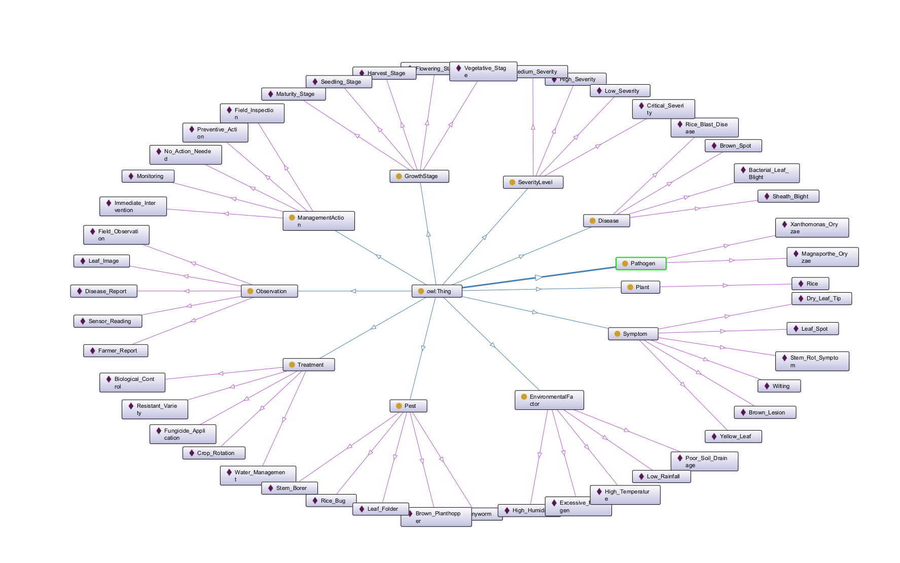

# Rice MMKG — Rice Multimodal Knowledge Graph

An OWL 2 ontology and multimodal knowledge graph modeling rice diseases, pests, pathogens, symptoms, environmental factors, growth stages, treatments, and management actions — populated from public image, sensor, light-trap and multispectral datasets, and a text layer that links curated assertions to the source passages stating them.



## Overview

Rice MMKG links agronomic, pathological, and entomological knowledge about rice cultivation into a single queryable graph, connecting what is *observed* (currently: 21,149 images from six datasets, 186 plot-level soil and weather observations, 11,533 light-trap catches of brown planthopper and 472 multispectral captures of brown spot; 296 text passages from 19 IRRI Rice Knowledge Bank fact sheets) to its *cause* (pathogens, pests, environmental stressors) and the *response* (treatments, management actions), contextualised by crop growth stage and severity level.

### Core Design Principles

- **Observation is kept separate from domain knowledge.** An `ImageObservation`'s raw dataset label (`annotatedAs`) is never conflated with curated symptom/cause/treatment relations (`captures`, `causes`, `indicatedBy`, ...) — what was recorded by computer vision is distinct from what is concluded by domain knowledge.
- **Every domain-level assertion is traceable.** All 612 populated domain assertions (0.9.1-dev, 2026-11-09: `causes`, `indicatedBy`, `occursIn`, `controlledBy`, `preventedBy`, `increaseRiskOf`, `vulnerableTo`, `recommends`, `requires`, `transmits`, `affectsPlantPart`, `partOf`, `hasTransmissionMode`, `hasManagementCategory`, `varietyOf`, `hasPathogenGroup`) are reified with `owl:Axiom` and carry `dcterms:source`, `dcterms:bibliographicCitation`, and `rice:evidenceType` — **100% provenance coverage as of v0.6.1**, checked by CQ-22 (assertions without an axiom) as well as CQ-21 (axioms without a source). v0.6 fell two assertions short of this; see the v0.6.1 note in [`Ontology_Overview.md`](Ontology/Ontology_Overview.md).
- **Formal reasoning & falsifiable Competency Questions.** Evaluated under automated Description Logic (HermiT/Pellet) and rule-based (OWL RL) reasoning across 27 schema-level Competency Questions without permissive `OPTIONAL` clauses.

### Metadata Snapshot

- **Namespace:** `https://w3id.org/ricemmkg#` — permanent identifier, live since 2026-09-16; version IRIs `https://w3id.org/ricemmkg/<version>` (releases up to v0.6.2 used `http://www.semanticweb.org/arifu/ontologies/2026/3/riceMMKG#`)
- **Format:** OWL/XML (`.rdf`), fully compatible with [Protégé](https://protege.stanford.edu/)
- **Version:** `0.9.0` (released 2026-11-07: the KG as the retrieval benchmark needs it — the full symptom inventory, IRRI (2018) *Rice Diseases* as a second text source, `rice:Sign`, and the inventory's provenance fixes). The file now reads `0.9.1-dev`: the management layer for CQ-12 and the evidence passages of 2026-11-09 were added after the tag. Earlier tags: `v0.8.1` (2026-11-07: symptom labels and provenance links corrected), `v0.8.0` (2026-11-07), `v0.7.0` (the data freeze of 2026-10-16, same commit as `data-freeze-2026-10`; the file there reads `0.7.0-dev`), `v0.6.2` and `v0.6.1` (2026-09-15), and `v0.6.0` (the v0.6 release of 2026-09-03, same commit as `elicited-baseline-v0.6`). Every tag `v<version>` resolves at `https://w3id.org/ricemmkg/<version>`. The data state used by downstream experiments is `v0.7.0` / `data-freeze-2026-10`.
- **Triples:** **328,321** asserted triples / **630,959** materialised triples under OWL RL (both measured 2026-11-09, 0.9.1-dev; v0.9.0: 327,853 / 630,369); the rise from 68,204 is the Paddy Doctor IEEE release, Dhan-Shomadhan images, the first sensor observations, the YUKE-WBC planthopper images, the stem borer symptom images, the nutrient deficiency images, the light-trap catches, the multispectral captures and 41 alignment links to SOSA, RiceDO and TreatO; v0.6.2: 66,802 / 161,447
- **Reasoner Consistency:** **100% Consistent** in HermiT & Pellet (0 unsatisfiable classes, 0 disjointness conflicts)

---

## Ontology Structure

### Classes (32)

31 classes in the `rice:` namespace and `dcat:Dataset`. The table lists the observation layer and the main domain classes; the others are `AbioticFactor` (6 individuals), `PlantPart` (10), `ManagementCategory` (4), `PathogenGroup` (4), `TransmissionMode` (1), `Variety` (12), `ResistanceAssessment` (15), `ResistanceLevel` (3), and, in the text layer added 2026-10-22, `TextDocument` (19) and `TextPassage` (296). Counts measured 2026-10-15, text layer 2026-10-22.

| Class | Individuals | Description |
|---|---:|---|
| `ImageObservation` | 21,149 | Paddy Doctor IEEE DataPort release 16,225, Dhan-Shomadhan 1,106, YUKE-WBC brown planthopper 66, stem borer symptom images 2,096, nutrient deficiency images 1,156 (Kaggle, licence not stated, permission requested) and 500 (Netrokona, potassium, label not expert-validated); the last four added 2026-10-13 |
| `SymptomaticObservation` | *(2,544 materialised)* | Defined class (`Observation that captures some Symptom`) — populated via OWL reasoning |
| `SensorObservation` | 186 | Plot soil tests (pH, EC, organic carbon, N, P, K) and weather, Rice Disease Risk Assessment v1.0, Odisha (2026-10-05) |
| `TrapObservation` | 11,533 | Light-trap catches of brown planthopper at 229 stations in China, 1977–2019, per five- or six-day period in July (2026-10-13) |
| `FieldLocation` | 418 | WGS84 points of the sensor observations (184), the light-trap stations (229), the multispectral captures (3), and one approximate location each for the YUKE-WBC and the Kaggle nutrient deficiency photos |
| `RemoteSensingObservation` | 472 | Close-range multispectral captures of brown spot and healthy rice, Colombia: one RGB image and five band images each (2026-10-14). The label is that of the plot; no NDVI is stored |
| `BandImage` / `SpectralBand` | 2,360 / 5 | One image file per band of a capture; the five bands of the camera (450–840 nm) |
| `Observation` | 0 | Abstract root observation superclass |
| `Dataset` (`dcat:Dataset`) | 9 | Metadata individuals for the Paddy Doctor, Dhan-Shomadhan, YUKE-WBC, stem borer symptom, Kaggle nutrient deficiency and Netrokona image collections, the Rice Disease Risk Assessment table, the brown planthopper light-trap table and the brown spot multispectral set |
| `Disease` | 15 | 9 biotic diseases (Bacterial Leaf Blight, Rice Blast, Tungro, Sheath Blight, Leaf Scald, etc.) and 6 abiotic disorders (N, P, K, Zn deficiency, iron toxicity, salinity; 0.7.0-dev) |
| `Pest` | 7 | Insect pests and vectors (Stem Borer, Leaf Folder, Brown Planthopper, Armyworm, Rice Bug, Hispa, Green Leafhopper) |
| `Pathogen` | 10 | Microbial causal agents (Magnaporthe Oryzae, Rhizoctonia solani, Xanthomonas pathovars, Microdochium albescens, RTBV, RTSV) |
| `Plant` | 1 | The host crop (*Oryza sativa*) |
| `HealthStatus` | 1 | Non-disease reference baseline (`Normal_Health`) |
| `Symptom` | 129 | Visible changes of the plant itself (Leaf Rolling, Deadheart, Dead Tiller, White Ear, Brown Lesion, Wilting, etc.); `Deadheart` was a `Disease` until 2026-10-28 |
| `Sign` | 21 | The organism, the pest or their products on the plant (bacterial ooze, fungal growth, sclerotia, eggs, larvae, adults, frass, silk); disjoint from `Symptom`, linked by the same `indicatedBy` (0.9.0-dev, 2026-11-07) |
| `GrowthStage` | 7 | Rice phenological stages (Seedling, Tillering, Vegetative, Reproductive, Flowering, Maturity, Harvest) |
| `EnvironmentalFactor` | 9 | Predisposing weather & field conditions (High Humidity, Waterlogged Soil, Dense Canopy, etc.) |
| `SeverityLevel` | 4 | Severity levels (Low, Medium, High, Critical), each annotated with the matching attack-intensity category of the 2021 Indonesian pest-observation guideline; no severity → action mapping is asserted (0.7.0-dev) |
| `Treatment` | 16 | Practical interventions (Fungicide/Insecticide Application, Biological Control, Resistant Variety, Crop Rotation, and fertilizer application for N, P, K and Zn) |
| `ManagementAction` | 5 | Operational actions (Field Inspection, Monitoring, Immediate Intervention, Preventive Action, No Action Needed) |

### Object Properties (44)

All declared with a domain and a range, except the entailed `hasAffectedPart` (range only) and `mentions` (domain only); inverse pairs share them in reverse.

- **Domain relations:** `causes`/`causedBy`, `transmits`/`transmittedBy`, `threatens`, `indicates`/`indicatedBy`, `controls`/`controlledBy`, `prevents`/`preventedBy`, `recommends`/`recommendedFor`, `requires`/`requiredFor`, `occursIn`, `hasOccurrenceOf`, `increaseRiskOf`/`riskIncreasedBy`, `vulnerableTo`, `affectsPlantPart`, `hasAffectedPart` (entailed by the chains `indicatedBy ∘ affectsPlantPart` and `hasAffectedPart ∘ partOf`, never asserted), `partOf`, `hasTransmissionMode`, `hasManagementCategory`, `hasPathogenGroup`.
- **Varieties and resistance:** `varietyOf`/`hasVariety`, `assessedVariety`/`hasResistanceAssessment`, `assessedAgainst`, `hasResistanceLevel`, `ofVariety`.
- **Observation layer:** `annotatedAs`/`annotationOf`, `captures`/`capturedBy`, `detects`/`detectedBy`, `hasSpatialLocation`, `hasBandImage`, `ofBand`.
- **Text layer:** `inDocument`, `mentions`.

*Epidemiological distinction:* `causes` is strictly scoped to `Pathogen → Disease`, while insect vector transmission is modeled through `transmits`/`transmittedBy` (`Pest → Pathogen`), enabling explicit graph traversal from vector to pathogen to disease.

### Datatype Properties (32)

- **Observation values:** `recordedAtDate`, `recordedUntilDate`, `hasCatchCount`, `plantAgeDays`, `environmentCondition`, `sourceLabel`; soil and weather `hasSoilPH`, `hasElectricalConductivity`, `hasOrganicCarbon`, `hasNitrogenLevel`, `hasPhosphorusLevel`, `hasPotassiumLevel`, `hasTemperature`, `hasHumidity`, `hasRainfall`; `hasNDVI`.
- **Places and bands:** `hasLatitude`, `hasLongitude`, `centreWavelengthNm`.
- **Assessments and labels:** `testedPopulation`, `testedLocation`, `reportedYear`, `sourceDatasetLabel`.
- **Text layer:** `startOffset`, `endOffset`, `textSha256`, `sectionTitle`; `passageText`, asserted only in text modules. Two annotation properties go with them on `owl:Axiom`: `hasEvidencePassage` and `evidencePassageCheck`.
- **Declared, not yet used:** `confidenceScore`, `severityScore`, `interventionThreshold`, `observationDate`, `hasNDVI`.

### Individuals & Provenance

- **36,748 named individuals** (2026-11-07, 0.9.0): 21,149 `ImageObservation` instances, 11,533 `TrapObservation` instances, 472 `RemoteSensingObservation` instances with 2,360 `BandImage`s, 186 `SensorObservation` instances, 418 `FieldLocation`s, 9 dataset metadata individuals, 22 `TextDocument`s with 311 `TextPassage`s, plus 286 domain entities (176 in 0.7.0-dev; 22 symptoms and 3 plant parts added in 0.8.0; 65 symptoms and 20 signs in 0.9.0-dev).
- **377 reified domain axioms** over 377 domain assertions: every assertion backed by an `owl:Axiom` record with `dcterms:source`, `dcterms:bibliographicCitation`, and `rice:evidenceType`. Source URIs: CABI Compendium 237 (as `doi.org/10.1079/cabicompendium.*` DOIs), IRRI Rice Knowledge Bank / Rice Doctor 100, NCBI Taxonomy 10, Paddy Doctor dataset 6, Mackill & Khush (2018) 3, AGROVOC 4, IRAC 4, Plant Ontology 2, Wang et al. (2022) 2, Bagariang et al. (2021) 2, Biswas et al. (2021) 1, FAO 1. The 15 resistance assessments carry the same three annotations on the assessment itself.
- **Vector transmission mode (0.7.0-dev):** both tungro viruses are recorded as semi-persistently transmitted (`hasTransmissionMode`), citing Wang et al. (2022).
- **Abiotic causes (0.7.0-dev):** nitrogen, phosphorus, potassium and zinc deficiency, and on the excess side iron toxicity and salinity, are modelled as `AbioticFactor`s that cause disorders, with symptoms from the IRRI Rice Knowledge Bank fact sheets — so abiotic factors, like pathogens, end at a Disease.
- **Varieties (0.7.0-dev):** `IR64`, `Angke` and `Conde` (bred from IR64), `Ciherang`, `Inpari_32` and `Inpari_33`. Each reported grade is a `ResistanceAssessment` naming the variety, the disease or pest, the grade (resistant, moderately resistant, susceptible), the tested biotype, race or population, the year and its own source — 15 assessments from Mackill & Khush (2018), Bagariang et al. (2021) and Biswas et al. (2021). Conflicting grades stay side by side, and a resistance that broke down shows as assessments from different years.
- **Management categories (0.7.0-dev):** treatments are classed as chemical, biological, cultural or host-plant-resistance control (`hasManagementCategory`, categories from AGROVOC) where a source places them unambiguously.
- **Plant anatomy (0.7.0-dev; extended in 0.8.0):** 13 `PlantPart` individuals, 12 of them aligned to the Plant Ontology (`Panicle_Neck` has no PO term; `Leaf_Collar` and `Glume`, added in 0.8.0, are close matches, looked up 2026-11-07); 123 of the 129 symptoms and 14 of the 21 signs linked to the organ they affect (`affectsPlantPart`), with `partOf` where the Plant Ontology records it. `Brown_Leaf_Tip` and `Yellow_Stripe` have no plant part since 0.8.1, because no readable source states it. **Known limitation:** `affectsPlantPart` is asserted per symptom, not per condition–symptom pair. A shared symptom therefore gives its part to every condition that uses it; for example, `Wilting → Whole_Plant` comes from the bacterial leaf blight sheet and also holds for blast through `hasAffectedPart` (symptom inventory §6.4, item 7; kept as is in 0.9.0-dev).
- **Visual symptoms from IRRI sources:** every visual feature that the IRRI fact sheets state is being added as a symptom of its own. For the three conditions without a fact sheet, the source is IRRI's book *Rice Diseases* (2018). See `Analysis and Alignment/Symptom_Inventory_2026-11.md`.
  - **Blast and brown spot (0.8.0):** lesion shape, centre, margin, halo and size; seedling, collar, neck and glume symptoms. The two no longer share all their leaf symptoms.
  - **Tungro and bacterial leaf blight (0.9.0-dev):** leaf colour patterns, lesion margin and progression, panicle and grain symptoms.
  - **Bacterial leaf streak, sheath blight, hispa, leaffolder, stem borer and brown planthopper (0.9.0-dev):** feeding marks and leaf mines, leaf folding, sheath lesion size and spread, bore holes, sooty mould.
  - **Leaf scald, downy mildew and bacterial panicle blight (0.9.0-dev, from IRRI 2018 *Rice Diseases*):**
    - lesion shape, size and halo;
    - twisted leaves, sheaths, panicles and florets;
    - soft rots;
    - panicle and grain symptoms.

    Bacterial panicle blight no longer shares nearly all of its symptoms with brown spot.
- **External Alignment**: 71 `skos:exactMatch`, 33 `skos:closeMatch`, 18 `skos:broadMatch`, 4 `skos:relatedMatch` to AGROVOC, NCBI Taxonomy, Plant Ontology, PECO, BFO, SOSA, WGS84, RiceDO v2 and TreatO v2 (counted 2026-10-19; one exactMatch and two closeMatch to the Plant Ontology added 2026-11-07). The observation layer is aligned to SOSA in [`SOSA_alignment.md`](Analysis%20and%20Alignment/SOSA_alignment.md); the measured comparison with RiceDO and TreatO is in [`RiceDO_TreatO_comparison.md`](Analysis%20and%20Alignment/RiceDO_TreatO_comparison.md) (both 2026-10-19).

### Paddy Doctor Dataset Alignment

The Paddy Doctor IEEE DataPort release (16,225 images) is the largest source; like every image set it is excluded from Git (`/Data/`). Each image keeps its folder label in `sourceLabel`; the entity it is `annotatedAs` is shown below.

| Paddy Doctor label | Images | Rice MMKG entity | Type | Observed symptom (`captures`) |
|---|---:|---|---|---|
| `normal` | 2,405 | `Normal_Health` | HealthStatus | — (reference baseline) |
| `blast` | 2,351 | `Rice_Blast_Disease` | Disease | — |
| `hispa` | 2,151 | `Hispa` | Pest | — |
| `tungro` | 1,951 | `Rice_Tungro_Disease` | Disease | — |
| `white_stem_borer` | 1,273 | `Deadheart` | Symptom | `Deadheart` |
| `brown_spot` | 1,257 | `Brown_Spot` | Disease | — |
| `leaf_roller` | 1,095 | `Leaf_Folder` | Pest | — |
| `downy_mildew` | 868 | `Downy_Mildew` | Disease | — |
| `yellow_stem_borer` | 765 | `Stem_Borer` | Pest | `Dead_Tiller` |
| `bacterial_leaf_blight` | 648 | `Bacterial_Leaf_Blight` | Disease | — |
| `black_stem_borer` | 506 | `Deadheart` | Symptom | `Deadheart` |
| `bacterial_leaf_streak` | 505 | `Bacterial_Leaf_Streak` | Disease | — |
| `bacterial_panicle_blight` | 450 | `Bacterial_Panicle_Blight` | Disease | — |

The 2,544 stem borer images (white, black and yellow) carry the only `captures` assertions in the graph: white and black to `Deadheart`, yellow to `Dead_Tiller`. `Deadheart` (sundep) is a `Symptom` of `Stem_Borer` since 2026-10-28, on a domain expert's advice. White and black stem borer images stay `annotatedAs Deadheart` until decision 5 of the 2026-09-30 meeting. Images of the other sets are listed under `ImageObservation` above.

### Modality Coverage & Data Gaps (0.7.0-dev)

Images currently cover 12 of the 15 `Disease` individuals and 4 of the 7 `Pest` individuals (`Hispa`, `Stem_Borer`, `Leaf_Folder`, `Brown_Planthopper`), as of 2026-11-07. The ontology conditions without any image are:

| Class | Without images |
|---|---|
| `Pest` | `Armyworm`, `Nephotettix_Virescens`, `Rice_Bug` |
| `Disease` | 3 abiotic disorders: Zn deficiency, iron toxicity, salinity. (N, P and K deficiency have images since 2026-10-13; the Kaggle source has no stated licence and the Netrokona potassium labels are not expert-validated) |

Every source checked so far, with the outcome and the reason, is recorded in [`Candidate_Datasets_Analysis.md`](Analysis%20and%20Alignment/Candidate_Datasets_Analysis.md): IEEE DataPort, the BRIN data repository, Mendeley Data, Zenodo, Figshare, Harvard Dataverse and Kaggle, searched 2026-10-05 to 2026-10-13. What remains open:

| Gap or open point | Status (2026-10-15) |
|---|---|
| Pest images: `Armyworm`, `Nephotettix_Virescens`, `Rice_Bug` | No usable source. A Mendeley pest set labelling these turned out to be collected from the web, with weevils filed as rice bug; IP102 is also web-collected |
| Abiotic disorders: Zn deficiency, iron toxicity, salinity | No image set found; symptom figures from CC BY papers are the remaining route |
| Licence or label to confirm | Kaggle N/P/K images (licence not stated, permission requested; to be removed if refused); Netrokona potassium labels and YUKE-WBC species (expert confirmation) |
| Candidates not yet imported | Weekly pest surveillance with weather, Midsayap, Philippines (needs `Scotinophara coarctata` as a new pest); brown planthopper resistance of 218 landraces; Sentinel-1 phenology table, Indramayu (licence "Custom"); UAV multispectral time series (no disease labels) |
| Per-image content beyond the label | Expert image annotation; lesion boxes (RiceLeafDiseaseBD, Mendeley) |
| Text | IRRI Rice Knowledge Bank, 19 fact sheets, 296 passages (2026-10-22), and IRRI (2018) *Rice Diseases*, 3 disease sections, 15 passages (2026-11-07). 397 curated assertions carry the passage that states them (2026-11-09, 0.9.1-dev), among them the cause, management and growth-stage facts that IRRI states. The wording is in [`Text Modality/`](Text%20Modality/), under CC BY-NC-SA 3.0 and 4.0 like the sources. Further text from CC BY papers is still open |
| Comparison with an existing ontology | Done for RiceDO v2 + TreatO v2 (2026-10-19): 23 mappings applied; TreatO's product–disease links not imported (no source per axiom; licence not stated in the files) |

Sources under CC BY-SA would go into a separate module brought in through `owl:imports`, so the core stays CC BY 4.0. The IRRI passage wording is held in two such modules:
- `Text Modality/RiceMMKG_IRRI_text.ttl` (CC BY-NC-SA 3.0);
- `Text Modality/RiceMMKG_IRRI_RD2018_text.ttl` (CC BY-NC-SA 4.0).

The core holds only pointers to them (offsets, sha256).

---

## Competency Question (CQ) SPARQL Benchmark

Rice MMKG incorporates an automated verification harness (`cq_sparql_benchmark.py`) based on **27 Competency Questions** structured across:
- **Reasoning Depth (L1–L4):** L1 Factual (1-hop), L2 Contextual (multi-criteria joins), L3 Causal (multi-hop chains), L4 Inferential (OWL RL deduction).
- **Knowledge Dimensions (D1–D3):** D1 Agronomic/Symbolic, D2 Cross-modal Grounding, D3 Provenance & External Alignment.
- **Evaluation Modes:** `coverage` (≥ 50%, an author-set convention; verdicts also reported at 40–80% — 22 / 22 / 21 / 20 / 17 PASS), `negative` (0 violations), `entailment` (entailed > asserted), `documented` (declared extension point).

### Benchmark Summary (0.9.1-dev, 2026-11-09)

```
================================================================
  PASS      22 / 26  (84.6% Pass Rate)
  PARTIAL    3 / 26  (CQ-18 Symptom Visual Grounding: 2%;
                      CQ-26 Pest Monitoring: 14%; CQ-27 Spectral Evidence: 7%)
  FAIL       1 / 26  (CQ-13 Severity Triage: 0%)
  DOC        1 / 27  (CQ-20 Sensor Observation Count)
================================================================
```

Measured 2026-11-09 on 0.9.1-dev: CQ-12 (management layer) passes since the batch of 2026-11-09, 17 of 22; CQ-18 is 3 of 129 symptoms (2%). v0.9.0: 21 / 4 / 1 / 1. CQ-17 and CQ-18 were extended and CQ-26 was added on 2026-10-13, and CQ-27 (diseases with spectral evidence; only `Brown_Spot` of 16) on 2026-10-15, so the figures are not directly comparable with earlier ones (see the changelog in [`Ontology_Overview.md`](Ontology/Ontology_Overview.md)). CQ-13 fails because the unsourced severity-to-action triage was removed. v0.6.1 and v0.6.2 score 23 PASS / 1 PARTIAL / 0 FAIL / 1 DOC. In 0.7.0-dev CQ-12 fell to PARTIAL when four nutrient-deficiency disorders — sourced, but with no ManagementAction in their source — joined its denominator; it was not lifted by adding unsupported assertions. The released v0.6 file scores 21 PASS / 1 PARTIAL / 2 FAIL / 1 DOC (CQ-10, CQ-24). Under the extended CQ-22 (2026-09-14), which also flags domain assertions carrying no provenance axiom, v0.6 has a third failure: two `Stem_Borer indicatedBy` assertions were never reified. v0.6.1 fixes all three.

- Complete documentation with exact SPARQL queries: [`Ontology/CQ SPARQL Benchmark/CQ_SPARQL_Documentation.md`](Ontology/CQ%20SPARQL%20Benchmark/CQ_SPARQL_Documentation.md)
- Automated execution report: [`Ontology/CQ SPARQL Benchmark/CQ_SPARQL_Benchmark_Report.md`](Ontology/CQ%20SPARQL%20Benchmark/CQ_SPARQL_Benchmark_Report.md)

---

## Roadmap

**Done in v0.7.0 (scaffolding and modalities; tagged at the data freeze of 2026-10-16; the 0.7.0-dev work after the freeze is in v0.8.0):**
- **Namespace:** w3id PURL `https://w3id.org/ricemmkg` live since 2026-09-16, namespace rewritten, maintenance plan in [`MAINTENANCE.md`](MAINTENANCE.md).
- **Schema:** plant parts, transmission mode, management category, abiotic causes, varieties and resistance assessments, all with a source per axiom.
- **Modalities:** nine sources and four observation channels, frozen on 2026-10-16 (tag `data-freeze-2026-10`). Image and text are the strongest modalities; sensor, light-trap and multispectral data are thin. A new source is admitted only if it closes a gap listed under [Modality Coverage & Data Gaps](#modality-coverage--data-gaps-070-dev).
- **Alignment:** AGROVOC, NCBI Taxonomy, Plant Ontology, SOSA, RiceDO v2 and TreatO v2.
- **Text layer:** IRRI Rice Knowledge Bank passages as a separate CC BY-NC-SA module, linked from the provenance axioms.

**Done in v0.8.0 (tagged 2026-11-07):** the symptom inventory of the 17 benchmark conditions (`Analysis and Alignment/Symptom_Inventory_2026-11.md`), and every visual symptom of blast and brown spot stated by IRRI.

**Done in v0.9.0 (tagged 2026-11-07): the KG as the benchmark needs it**
1. the inventory rows of the conditions that have an IRRI fact sheet: **done (0.8.0 and 0.9.0-dev)**. Signs were added as `rice:Sign` (decision M4), field patterns as symptoms without a plant part (M6), and the two ambiguous rows with a visible feature (M7), all in 0.9.0-dev;
2. the provenance issues of the inventory's §6.4: items 1–4 **done (v0.8.1)**, items 5–8 **done (0.9.0-dev)** (item 7 kept as a known limitation);
3. sources for the three diseases without an IRRI fact sheet (leaf scald, downy mildew, bacterial panicle blight): **done (0.9.0-dev)**, from IRRI (2018) *Rice Diseases*;
4. the Normal_Health decision: **done (0.9.0-dev)**, option (b): no KG content for normal appearance; one fixed prompt in the benchmark;
5. Plant Ontology lookup for `Leaf_Collar`, `Coleoptile` and `Glume`: **done (0.9.0-dev)**;
6. the domain-expert questions of the symptom inventory (§7.4): **open**, waiting on the domain expert; carried over to v1.0 with the expert validation below.

**After v0.9.0 (0.9.1-dev):** the management layer for CQ-12 (2026-11-09): 10 `recommends` links to a `ManagementAction`, each stated by an IRRI passage; CQ-12 9/22 → 17/22 (PASS). Then evidence passages for 72 existing cause, management and growth-stage assertions (2026-11-09), for evidence retrieval.

**Toward v1.0: FAIR and finalisation**
1. **Release tooling:** pyLODE or Widoco documentation at the PURL (the browser redirect then points to it), FOOPS! and OOPS! checks, Zenodo DOI, AgroPortal.
2. **Distribution:** a smaller ontology file served at the namespace, with the image observations distributed separately.
3. **Validation:** expert validation of the elicited CQs (weighted κ or Krippendorff's α).

**Open, not tied to a version:**
1. **Labels and licences:** the Kaggle licence request, expert checks of the Netrokona and YUKE-WBC labels, and decision 5 on the white and black stem borer images (still `annotatedAs Deadheart`).
2. **Expert input:** the severity → action mapping (CQ-13) and the image annotation package for abiotic disorders and sheath blight.

The history of each change is in the changelog, [`Ontology_Overview.md`](Ontology/Ontology_Overview.md); the phase plan of September 2026 (ESWC 2027, not pursued) was removed on 2026-11-09 and is kept at tag [`v0.9.0`](https://github.com/Ariful-Furqon/Rice-Multimodal-Knowledge-Graph/blob/v0.9.0/Ontology/riceMMKG_ESWC_plan.md).

Retrieval experiments that use this graph are kept in a separate repository, which includes this one as a git submodule pinned to the version used.

---

## Repository Layout

| Path | Contents |
|---|---|
| [`Ontology/`](Ontology/) | `Rice MMKG.rdf` (the graph), the patch file, [`Ontology_Overview.md`](Ontology/Ontology_Overview.md) (changelog) |
| [`Ontology/CQ SPARQL Benchmark/`](Ontology/CQ%20SPARQL%20Benchmark/) | CQ benchmark, elicited CQs, LLM elicitation prompts and runs, CQ screening data (anonymised) |
| [`Text Modality/`](Text%20Modality/) | IRRI passage modules (Rice Knowledge Bank, CC BY-NC-SA 3.0; *Rice Diseases* 2018, CC BY-NC-SA 4.0) and the scripts that build them |
| [`Analysis and Alignment/`](Analysis%20and%20Alignment/) | Dataset analyses and alignments (AGROVOC, NCBI Taxonomy, Planteome, SOSA, RiceDO/TreatO) |
| [`w3id/ricemmkg/`](w3id/ricemmkg/) | Mirror of the w3id.org redirect rules |

**Kept locally, not in Git:**
- `Data/` (images and derived retrieval files);
- `Worklog/` (per-task scripts and reports);
- `Multimodal Fusion PoC/` (early TransE/IKRL prototypes);
- `Ontology/Backup/`;
- raw expert input, the expert questionnaire with names, and the CQ screening internals.

Documents may cite paths in these folders as a record of how the work was done. The paths cannot be opened on GitHub. The image URLs in the graph (`schema:contentUrl`) are paths under `Data/`.

---

## Quick Start & Verification

### In Protégé
1. Open `Ontology/Rice MMKG.rdf` in Protégé 5.x.
2. Select **`Reasoner` → `HermiT`** (or `Pellet`).
3. Press **`Ctrl + R`** (`Start reasoner`). The reasoner will confirm global consistency (0 unsatisfiable classes) and classify 2,544 images under `SymptomaticObservation`.

### Through the permanent IRI
```bash
curl -L -H "Accept: application/rdf+xml" https://w3id.org/ricemmkg -o "Rice MMKG.rdf"        # latest (main)
curl -L https://w3id.org/ricemmkg/0.6.2 -o "Rice MMKG-0.6.2.rdf"                              # a release
```

### Programmatic SPARQL Benchmark via Python
Run the automated benchmark suite with OWL RL deductive closure:

```bash
python "Ontology/CQ SPARQL Benchmark/cq_sparql_benchmark.py"
```

```python
import rdflib

g = rdflib.Graph()
g.parse("Ontology/Rice MMKG.rdf", format="xml")
print(f"Asserted triples loaded: {len(g)}")
```

---

## Citation & License

**Authors & curators:** Muhammad Ariful Furqon (ORCID: [0000-0002-1031-3567](https://orcid.org/0000-0002-1031-3567)), Natthawut Kertkeidkachorn (ORCID: [0000-0003-4527-776X](https://orcid.org/0000-0003-4527-776X)).

**Licences** (details in [`LICENSE`](LICENSE)):
- **Ontology and knowledge graph data:** [CC BY 4.0](LICENSE#part-2-creative-commons-attribution-4-0-international-cc-by-40).
- **Scripts and benchmark tooling:** [MIT](LICENSE#part-1-mit-license-software-scripts-and-benchmark-tooling).
- **IRRI passage text:** each module has the licence of its source:
  - `Text Modality/RiceMMKG_IRRI_text.ttl`: CC BY-NC-SA 3.0;
  - `Text Modality/RiceMMKG_IRRI_RD2018_text.ttl`: CC BY-NC-SA 4.0.

  They are separate modules; the CC BY core holds only pointers to them.
<!-- - **Cite as:**
  ```bibtex
  @misc{ricemmkg_2026,
    title  = {Rice MMKG: A Multimodal Knowledge Graph and Domain Ontology for Rice Disease and Pest Diagnosis},
    author = {Muhammad Ariful Furqon and Natthawut Kertkeidkachorn},
    year   = {2026},
    note   = {Version 0.6, evaluated with 25 Competency Questions and OWL RL reasoning}
  }
  ``` -->
